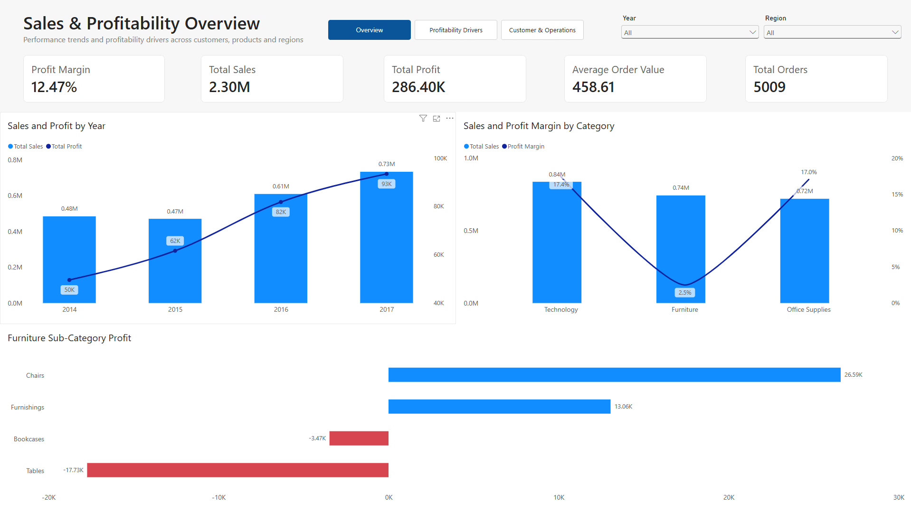
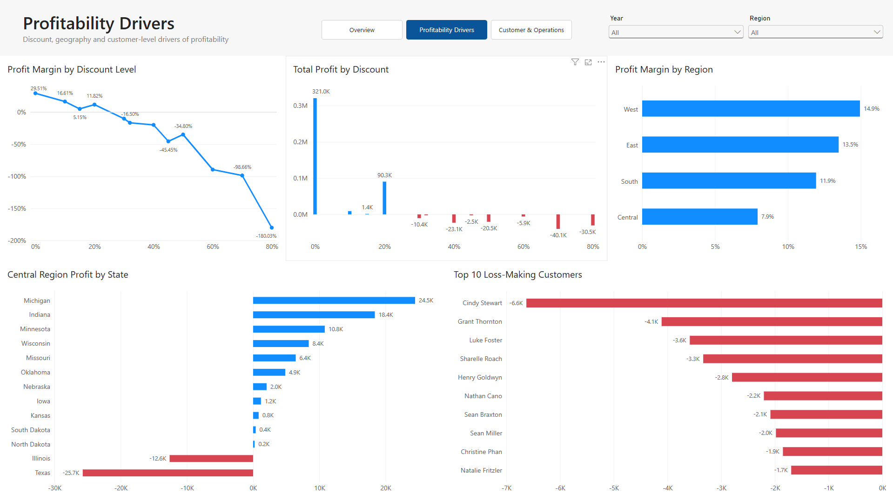
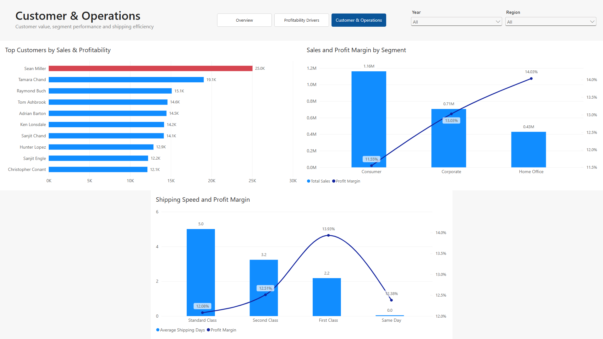

# Sales & Profitability Analysis

**Tools:** SQL Server | SSMS | Power BI | Excel

## Project Overview

This project analyzes retail sales data to evaluate business performance and uncover the factors associated with profitability. Using SQL Server and Power BI, I analyzed 9,994 transaction-level records across product categories, 
discount levels, geographic regions, customer segments, time periods, and shipping methods. The final output is a three-page interactive Power BI dashboard supported by key business insights and data-driven recommendations focused on areas associated with lower profitability.

## Business Objective

The οbjective was to identify the main drivers of sales and profitability, locate loss-generating areas, and uncover opportunities to improve business performance across products, customers, regions, discounts and overall operation.

## Dataset

The dataset contains 9,994 transaction-level records representing 5,009 unique orders from 2014 to 2017. 
Each row represents an individual order line and includes information on products, categories, geographic location, sales, discounts, profit, shipping methods, and order/ship dates. 
The dataset also includes derived fields for profit margin, shipping days, month, and year, all of which were validated before analysis.

## Tools Used

- Excel – Initial data preparation
- SQL Server / SSMS – Data cleaning, validation, and analysis
- Power BI – Data modeling, DAX, and dashboard development

## Data Preparation & Cleaning

- Validated row count, date ranges, null values, duplicates, and all derived fields before analysis.
- Corrected Customer ID casing inconsistencies.
- Removed trailing whitespace from Product Names.
- Converted Postal Code from numeric to text, to preserve leading zeros.
- Investigated duplicate entries, retained due to insufficient evidence to classify as errors.
- Verified Shipping Days, Year, Month and Profit Margin generated columns matched their source values.

## Exploratory Data Analysis

The analysis focused on understanding how sales and profitability varied across the business and identifying where losses were concentrated.

Key areas explored included:

- Overall sales, profit, profit margin, order volume, and average order value
- Yearly and monthly performance trends
- Category and sub-category profitability
- The relationship between discount levels and profitability
- Customer segment performance
- Regional and state-level profitability
- Top customers by sales and largest loss-making customers
- Shipping mode performance and average shipping time

## Power BI Dashboard

The Power BI report was designed as a three-page interactive dashboard:

- **Sales & Profitability Overview** – Executive KPIs, yearly performance, category profitability, and Furniture sub-category performance.
- **Profitability Drivers** – Discount-level profitability, regional and state performance, and top loss-making customers.
- **Customer & Operations** – Top customers by sales, segment performance, and shipping efficiency.

The dashboard includes synchronized Year and Region slicers, consistent navigation, and conditional formatting to highlight profitable and loss-making areas.

## Key Insights

- Sales grew strongly after 2015, reaching the highest level in 2017, while overall profitability remained positive throughout the period.

- Furniture was the weakest-performing category, with Tables and Bookcases generating losses despite meaningful sales volume.

- Discounting emerged as the strongest recurring profitability pattern. Discounts of 30% and above generated aggregate losses, while Tables became loss-making at every observed discounted level.

- The Central region had the lowest regional profit margin, with losses concentrated primarily in Texas and Illinois. Both states also showed substantially higher average discounts than other Central states.

- High customer sales did not always translate into profitability. Sean Miller was the highest-sales customer but generated an overall loss, with most of his sales occurring at a 50% discount.

- Cindy Stewart was the largest loss-making customer, with losses heavily concentrated in transactions discounted by 70%.

## Business Recommendations

- Review discount policies, particularly for discounts of 30% and above, as these levels were consistently associated with losses.

- Investigate pricing and discount strategies for Tables and Bookcases, with particular attention to whether current promotions are deteriorating margins.

- Prioritize a profitability review of Texas and Illinois, where regional losses were concentrated and average discount levels were substantially higher.

- Evaluate high-revenue but loss-making customers individually to determine whether pricing, discounting, or product mix can be adjusted without damaging customer relationships.

- Introduce profitability monitoring alongside sales targets so that high sales volume is not treated as a success metric in isolation.

- Continue tracking shipping efficiency, but avoid major operational changes based solely on shipping mode, since profitability differences across shipping methods were relatively small.

## Project Files

- `01_Data_Validation.sql` – Data profiling, validation, and quality checks
- `02_Data_Cleaning.sql` – Data cleaning and schema corrections
- `03_Exploratory_Data_Analysis.sql` – Business-focused exploratory analysis
- `Sales_Profitability_Dashboard.pbix` – Interactive Power BI dashboard
- `images/` – Dashboard screenshots used in this README

## Dashboard Preview

### Profitability Drivers

### Customer & Operations

