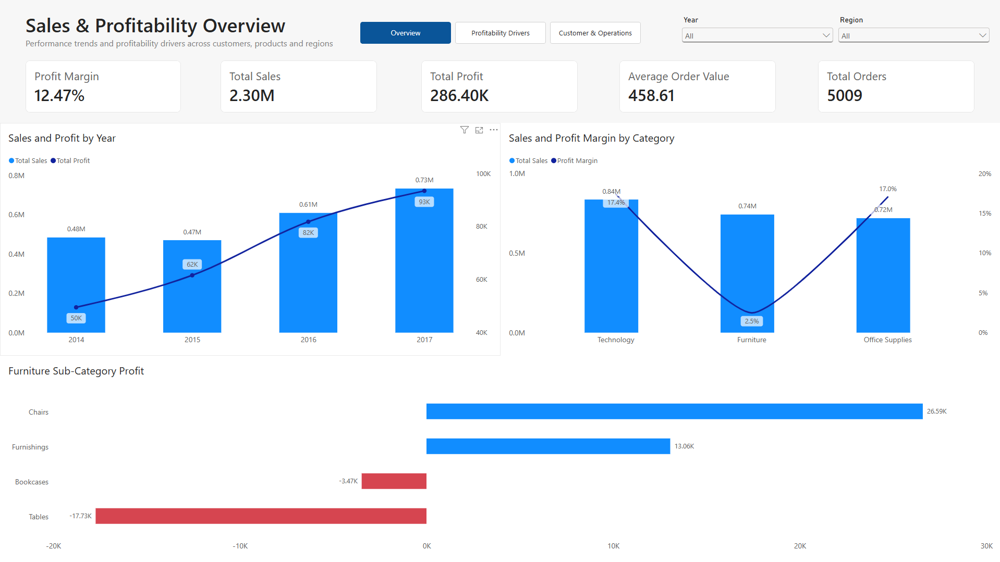
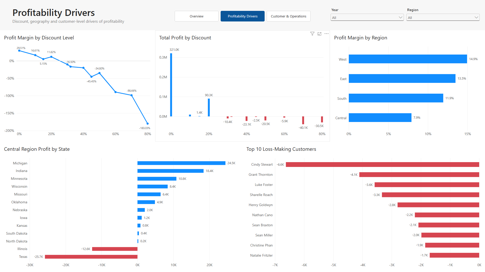
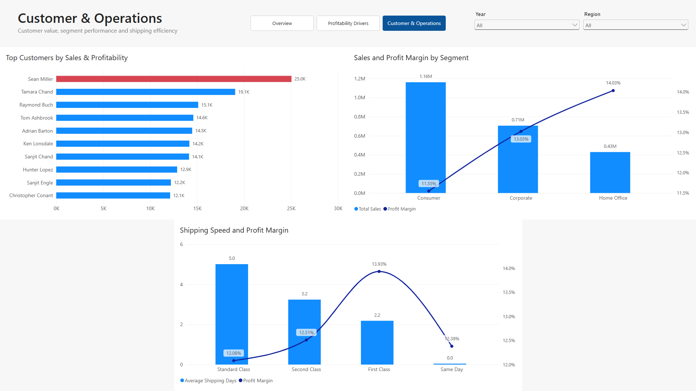

📊 Sales & Profitability Analysis

SQL Server + Power BI project focused on sales performance, profitability drivers, discount impact, and loss-making areas.

🎯 Objective

Identify the main factors associated with profitability and highlight opportunities to improve margins across products, customers, regions, and discount levels.

🛠️ Tools

SQL Server / SSMS

Power BI

Excel

🧹 Data Preparation

Validated row counts, dates, nulls, duplicates, and derived fields

Corrected Customer ID casing

Removed trailing spaces from Product Names

Converted Postal Code to text

Verified Shipping Days, Year, Month, and Profit Margin fields

🔎 Key Insights

📈 Sales peaked in 2017

🪑 Furniture was the weakest category

📉 Tables and Bookcases generated losses

💸 Discounts of 30%+ were associated with aggregate losses

📍 Central had the lowest regional profit margin

⚠️ Texas and Illinois concentrated much of the regional loss

👤 High sales did not always mean high profitability

🚨 Sean Miller generated high sales but an overall loss

🔻 Cindy Stewart was the largest loss-making customer

💡 Recommendations

Review discounts of 30% and above

Reassess pricing for Tables and Bookcases

Investigate profitability in Texas and Illinois

Monitor profit alongside sales for key customers

Review high-revenue but loss-making customer accounts

Continue tracking shipping efficiency, but avoid major changes based on shipping mode alone

📊 Dashboard Preview

🧭 Sales & Profitability Overview

Executive KPIs, yearly performance, category profitability, and Furniture sub-category performance.

🔍 Profitability Drivers

Highlights discount impact, regional profitability, state-level performance, and loss-making customers.

👥 Customer & Operations

Focuses on top customers, customer segments, and shipping performance.

📁 Project Files

[01_Data_Validation.sql](./01_Data_Validation.sql)

[02_Data_Cleaning.sql](./02_Data_Cleaning.sql)

[03_Exploratory_Data_Analysis.sql](./03_Exploratory_Data_Analysis.sql)

[Sales_Profitability_Dashboard.pbix](./Sales_Profitability_Dashboard.pbix)

[images/](./images)

